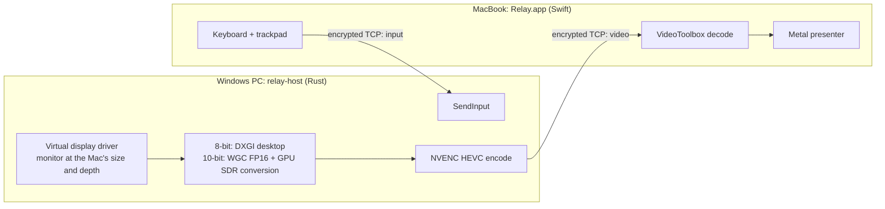

# Relay

**Use a MacBook as a 120 Hz monitor for a Windows PC, over one Ethernet cable.**

[](host/)
[](client/)
[](LICENSE)
[](https://github.com/theamanali/relay/actions/workflows/host.yml)
[](https://github.com/theamanali/relay/actions/workflows/client.yml)

<!-- Demo: docs/media/demo.gif (20–30 s): plug in the cable, pick the PC, a game running at 120 Hz on the MacBook -->

Plug the cable in, open Relay on the Mac and pick the PC. Windows gets a new
monitor at the Mac's exact native resolution, streams it to the Mac at 120 fps
with hardware HEVC, and takes the Mac's keyboard and trackpad back as input.
Disconnect, and the virtual monitor disappears and the PC's own monitors come
back as they were.

It started as a way to travel with a desktop PC and no monitor: the MacBook
already has a great 120 Hz screen. Relay is one Rust service on Windows, one
native Swift app on macOS, and a small encrypted protocol between them,
deliberately smaller than Sunshine + Moonlight: no game launcher, no settings
UI, and pairing is one PIN, once.

**Built with:** Rust · Swift · Win32 / DXGI / Direct3D 11 · NVENC · VideoToolbox ·
Metal · SwiftUI / AppKit · Network.framework · Noise · CPace · X25519 / ChaCha20-Poly1305 ·
mDNS / Bonjour · Windows services · GitHub Actions

## Highlights

- **3024×1964 at 120 fps** (a 14-inch MacBook Pro's native panel), captured and
  encoded entirely on the GPU. Stable in exclusive-fullscreen games (Valorant,
  EA Sports FC 26).
- **About 6 ms of work per frame on the PC and about 4 ms on the Mac** from
  receiving a frame to putting it on screen. Measured, not estimated; see
  [Performance](#performance).
- **End-to-end encrypted** with standard, analysed constructions: a
  `Noise_XX_25519_ChaChaPoly_SHA256` handshake and CPace, a PAKE, for the
  one-time PIN pairing. There is a [written wire spec](docs/PROTOCOL.md) and a
  shared test vector, and each side is also checked against the published
  Noise and CPace vectors.
- **No network setup.** The Mac finds the PC over Bonjour on the IPv6
  link-local addresses both machines assign the moment a cable is up, so a bare
  cable with no DHCP works. A home LAN or Tailscale works too.
- **Leaves no trace.** The virtual monitor exists only during a session. The
  PC's display layout is restored on disconnect, Ctrl-C or a killed process.

## How it works



1. **Virtual monitor.** Windows only shows monitors that come from a display
   driver, so the host drives the open-source, signed
   [MTT Virtual Display Driver](https://github.com/VirtualDrivers/Virtual-Display-Driver).
   When a Mac connects, the host snapshots the display layout, enables the
   driver's device and makes the virtual monitor the *only* display, at the
   Mac's exact pixel size and refresh rate.
2. **Capture and encode.** 8-bit sessions use DXGI Desktop Duplication; 10-bit
   SDR sessions use Windows Graphics Capture FP16 and GPU conversion to RGB10.
   Both are encoded by NVENC in the host; a SYSTEM host uses a signed-in-user
   capture helper from the same binary and shares its RGB10 texture. Frames never
   leave the GPU. Only NVIDIA GPUs are used, and each session is checked
   against the GPU's NVENC capabilities before any display changes.
3. **Transport.** One TCP connection with length-prefixed, encrypted frames
   ([spec](docs/PROTOCOL.md)).
4. **Pairing.** Each side has a long-lived identity key. The first connection
   asks for the 6-digit PIN shown in the PC's tray; after that the two machines
   recognise each other by key, and every session derives fresh keys from an
   ephemeral exchange.
5. **Mac client.** VideoToolbox decodes in hardware into IOSurface-backed
   buffers, which a Metal presenter draws with no extra copy and at most one
   frame waiting. Keyboard and trackpad events go back over the same connection.

## Performance

The measurements below use the original 8-bit desktop source, including
encoding-only Main10 results. The true 10-bit WGC source is not yet qualified
on the real Mac.

Per frame at 3024×1964, 120 fps, HEVC, default settings, on the real hardware:

| stage | time |
|---|---|
| Capture (desktop copy, cursor, submit) | 0.2 ms |
| Encode (NVENC) | 4.3–5.9 ms |
| Encrypt + send | 0.07 ms |
| **PC total**, p50 / p95 | **5.9 / 6.5 ms** |
| Mac: received → decoded, p50 | 2.6 ms |
| **Mac: received → on screen**, mean / p95 | **4.2 / 5.3 ms** |

Mac timings start after decryption. Network transit and the panel's own response
time are not included; a camera-based screen-to-screen measurement is on the
[roadmap](#status). How these were measured, what moved them and what was
tried and rejected: **[docs/LATENCY.md](docs/LATENCY.md)**.

### Finding a hidden 0–8 ms

The host originally captured on its own fixed 120 Hz timer. Logging how old each
captured frame was showed that the timer drifted against the virtual display's
refresh: every session picked up a random 0–8 ms of extra delay and kept it, and
none of the existing latency numbers could see it. The capture loop now steers
its timer to land just after each new desktop frame:

| | average frame age at capture, per session |
|---|---|
| before | 0.7, 7.4, 5.5 and 2.6 ms (max 8.5) |
| after | 1.2 ms every session (max 1.6) |

The Mac's p95 time to screen dropped by 1.8 ms as a result. Two simpler fixes
were measured and rejected; both are written up in
[docs/LATENCY.md](docs/LATENCY.md#the-hidden-08-ms).

## Design decisions

- **TCP, not WebRTC or custom UDP.** On a dedicated cable there is no packet
  loss and no competing traffic, so jitter buffers and error correction would
  only add latency.
- **Steady capture timer, not "send each frame the moment it appears".**
  Sending on arrival was 0.7 ms faster but visibly juddered, because the virtual
  display's refresh is a software timer that jitters by milliseconds.
- **Don't wait inside the capture call.** Blocking in `AcquireNextFrame` holds
  the shared GPU device lock, which stalls the encoder for a full frame. The
  capture thread polls every 200 µs instead.
- **Switch the virtual display's device on and off rather than reconfiguring
  the driver.** The driver's own control commands crash it, and Windows gives up
  on it after five crashes. While a session runs, the PC's physical monitors are
  disabled too, so fullscreen games can't switch back to them.
- **A Windows service with a SYSTEM-level worker.** Screen capture and input
  injection only work from the active desktop, and a normal user process can't
  open the lock or login screen. Running the worker as SYSTEM in the signed-in
  session lets those screens stream and lets the service restore the PC's
  monitors if the worker crashes. (Implemented; hardware verification in
  progress.)
- **A PIN, checked with a PAKE.** The first pairing proves the PC's six-digit PIN
  with CPace inside a Noise XX channel, and the PC proves it back. Someone in
  the middle gets one guess per attempt (rate-limited) and nothing to test
  offline; after that the pinned keys make impersonation impossible on any
  network. CryptoKit has no field arithmetic, so the Mac computes the PIN's
  curve point with about 150 lines of TweetNaCl-style code, timing-tested for
  input independence (`client/Tools/ctcheck.swift`).

## Status

**True 10-bit SDR (implementation; SYSTEM deployment pending, 2026-10-19):** the existing toggle now
sets MTT's SDR10bit option before device start, restores its original colour
switches on cleanup/crash recovery, captures FP16 SDR through Windows Graphics
Capture, converts linear scRGB to SDR RGB10 on the selected GPU, and composes
the cursor into RGB10 before NVENC ABGR10 input. SYSTEM uses a signed-in-user
capture helper with GPU texture sharing; 10-bit needs the user's Default
desktop, while 8-bit remains the login/secure-screen path. Desktop Duplication remains
the 8-bit source and supplies cursor information for 10-bit sessions: it
returned BGRA8 even when this MTT display reported 10 bits/channel. Unsupported
capture/conversion fails without an 8-bit-source fallback; HDR remains separate.

Numeric desktop tests on an unchanged physical display retained **64/64**
adjacent codes in each native 10-bit R/G/B/gray ramp after capture and GPU
composition, with zero code error; the 8-bit path retained **16/64**. Both
Main10 4:2:0 and Rext 4:4:4 production dumps decoded with finer gradients than
the 8-bit baseline, correct channels and SDR VUI. Windows tests, strict clippy
and release build pass. The GPU-sharing helper also preserves all 64 codes
in an ordinary-user process test. Final SYSTEM installation/verification is
pending Windows elevation; the installed intermediate build currently
withholds 10-bit. Virtual-display source qualification, SYSTEM/secure
desktop recovery and real-Mac performance remain pending in
[SESSION-HANDOFF.md](SESSION-HANDOFF.md). WGC's timestamp is not the protocol's
DWM LastPresentTime: true 10-bit sessions currently leave Desktop → screen /
content-age timing unknown; other timings remain available. Earlier claims
that 10-bit was free measured an **8-bit capture encoded into Main10**.


**Display scale (2026-10-18):** the Mac now tells the PC which Windows scale
to use for the virtual display (PROTOCOL.md "Display scale"): the requested
pixel width over the Mac screen's width in points, so native Retina asks for
200%, `--scale 0.75` for 150% and a 1× screen for 100% (never less). The PC
applies it live before the first frame and puts the previous value back on
disconnect, after a crash and in `restore`; physical monitors are never
touched, and older PCs get today's CLIENT_HELLO. Checked on Windows with unit
tests, clippy, a set/restore trial on a physical monitor and a `--no-vdd`
probe session (installed as the service), and on the Mac with unit tests,
isolated loopback checks and the real app against `fakehost`. The check on
the real virtual display is in [SESSION-HANDOFF.md](SESSION-HANDOFF.md).

**End-to-end timing (2026-10-18):** the Mac and PC now relate their clocks
(PROTOCOL.md "Clock sync and frame timing"), so the detailed latency HUD and
the session report measure a frame from Windows' present to the Mac's screen,
and an input event to `SendInput`. First real-PC session over the cable
(3024×1964@120, Fastest, 4:4:4 10-bit, 40 s, synthetic pointer motion):
**desktop → screen p50 14.9 / p95 23.3 ms** (content age 3.3, PC work 7.1,
sent → received 0.4, receive → screen 4.4) and **input → applied p50 1.1 ms**.
Verified with 182 Mac tests, the isolated fakehost checks and fakehost with
known clock offsets; the wire format is in [PROTOCOL.md](docs/PROTOCOL.md).

**Platform migration (2026-10-10):** the Mac now uses SwiftUI for the picker,
settings, PIN sheet and commands, Swift 6 language mode, and an arm64-only
bundle with a macOS 14 minimum (Observation; raised to macOS 26 on 2026-10-18). Metal and hardware decoding are
required. All 107 Mac unit tests, isolated fakehost checks and the signed local
release bundle pass on macOS 27.0. The Windows side of the migration is done
(2026-10-17, below):
NVIDIA-only encoding with a preflight (phase A), the failure/recovery gate on
the real Mac and PC (phase B), and a single native backend with ffmpeg, AMF,
Quick Sync, software encoding and Parsec removed (phase C), installed as the
service and measured on the real Mac with no latency regression. Still pending:
qualification on the minimum (macOS 26) and latest stable macOS, and Developer
ID notarization. Older hardware streaming results below predate this migration.

**NVIDIA enforcement, host phase A (2026-10-17):** the host only selects NVIDIA
adapters (an explicit `--gpu` must name one; other adapters stay listed),
refuses a driver below NVENC API 12.1 with an update message, reads a
capability record from a short NVENC session (no capture, no display change),
and preflights every session against it, including a trial initialization of
Relay's real encoder configuration, before any display is touched. After
attach it requires the display on the selected GPU and rechecks a changed
mode; capture start and restart check the adapter and size; a mismatch
restores the layout. `relay-host encoder-caps` prints the record. Unit-tested
(204 tests plus the probe integration test), strict clippy on Rust 1.98 and
1.99, release build; `encoder-caps` on this RTX 3080 Ti (driver 616.56, NVENC
API 13.1, Windows 11 26200) initializes every HEVC/H.264 preset and picture
option at 3024×1964@120.

**Failure/recovery gate, PC half (2026-10-17):** 17 dev-host cases with `probe`
(`--no-vdd`, no virtual display) passed: preflight refusals (no common codec,
oversized mode, a forced driver refusal) before any display change, the
post-attach GPU check, an old-driver refusal at startup, BUSY, refresh and
resolution changes mid-session (restarts refused at the wrong size, the session
ended after 15 s when it stayed wrong), and a desktop the host may not capture
for 20 s. That last case found a lock-screen wait that never engaged for
non-SYSTEM hosts, fixed. Another case found that a session starting while the
previous one's capture is still being torn down cannot start native capture;
ffmpeg covered that silently, so the native retry below handles it now.

**Failure/recovery gate, exclusive-display half (2026-10-17): passed.** The
real Mac ran through the installed service:
- 3024×1964@120 Balanced sessions in 4:2:0 8-bit (105–108 fps) and in 4:4:4
  10-bit (about 95 fps), with a quick reconnect;
- lock and unlock, including connecting to a locked PC;
- a graphics-driver restart (Win+Ctrl+Shift+B) mid-session, which recovered
  in 1.7 s;
- a killed worker, after which the service restored the monitors and started
  a new worker in 5 s.

A simulated hybrid mismatch on the virtual display rolled back the layout in
1.4 s, and an oversized mode was refused without touching the monitors. The
physical layout came back after every case. After the killed worker the Mac
found the PC again only once Relay was reopened: the dead worker sent no mDNS
goodbye, and mdns-sd announces a new record only twice, in its first second.
The host now announces each new record again 3, 8, 16, 32 and 60 s after
registering it, and nothing after that. That alone did not fix it. Mac captures
on 2026-10-17 Pacific (2026-10-18 UTC) found that Bonjour still resolved full
TXT while the app's long-lived browser retained a TXT-less result. The Mac
now recreates the browser at 2.5, 10 and 30 s after a known row disappears,
or after a picker dial fails before connecting, keeping the existing row
grace and saved pairings. All 164 Swift tests, isolated pairing checks and
a fakehost SIGKILL/restart smoke check pass. Real-PC idle and mid-session
kills have kept or recovered the row without reopening Relay, with PIN-free
reconnects. A reproduced stuck-TXT case returned in 13.5 s through the new
browse restart; one reconfirm/PTR-flush run with the diagnostic browse still
active took 39.5 s after row removal, so a universal 30 s bound is unproven.
Detailed results and limits are in the
[Mac verification record](client/README.md#worker-crash-rediscovery-finding-6).
The PC session maintains [its retest record](host/NVIDIA-RECOVERY-RETEST.md).

**One native backend (2026-10-17, phase C):** the ffmpeg, AMF, Quick Sync and
software encoders, `--ffmpeg`/`--no-native`, and the Parsec driver with its
installer and `--driver` options are gone. A capture that starts while the
previous one is still being torn down waits for it (up to 3 s) and retries the
busy output (up to 2 s); any other failed start or restart goes to the
session's recovery loop, with each failure classified in the log. Unit tests,
strict clippy and a release build pass; an opt-in test on this PC starts a
second duplication of a real output through the retry. A rerun of the dev-host
cases passed on this build, including an H.264 session 1.5 s after a 4:4:4
10-bit one, now native at 125 fps; the build is installed as the service.
On the real Mac at the `docs/LATENCY.md` baseline's settings (3024×1964@120
Balanced, static desktop) it matches the baseline: PC work 18.5 ms p50 against
18.7, decode 2.2 against 2.2, time to screen 3.5–3.8 against 3.5 ms, 107 fps shown
against 102 ([details](docs/LATENCY.md#the-nvidia-only-host-against-that-baseline-2026-10-17)).

**Clock sync and per-frame timing, host half (2026-10-18):** a host with
capability `0x04` answers TIME_REQUEST with NTP-style receive/send stamps on
its QPC clock and, for a client that asked, sends FRAME_TIMING_EXT after every
frame: DWM's present time, encoder submit, socket send, and an input counter
with the time of the last input applied. With these the Mac can measure desktop
→ its screen and input → `SendInput` end to end
([spec](docs/PROTOCOL.md#clock-sync-and-frame-timing)). Unit-tested, strict
clippy, release build; `probe --timing` against a `--no-vdd` dev host on
loopback measured a clock offset of 0–4 µs, no fresh frame out of order, every
input counted, and input → applied 0.13 ms p50. Installed as the service, where
a 3024×1964@120 probe session on the virtual display measured the same (offset
5 µs, frames in order, inputs counted) and restored the layout. The Mac side
followed the same day (above).

**Working and verified on the real hardware:** the virtual monitor at the
Mac's native mode with the PC's layout restored afterwards; in-process capture
and NVENC encode at 3024×1964 @ 120 in exclusive-fullscreen games; pairing,
encryption, discovery and forgetting a pairing from either side; the Mac app
(PC picker, hardware decode, Metal presentation, keyboard and trackpad); the
Windows tray menu.

On 2026-10-09, the real Mac and PC passed protocol v4 existing/fresh pairing,
wrong-PIN rejection, Forget from either side, reconnect without a PIN, and
3024×1964@120 streaming. Normal disconnect restored physical monitors and layout.
Lock/unlock during a stream and connecting while already locked passed. One
reboot → login-screen connection → sign-in from the Mac passed; an earlier reboot
and sign-out/reconnect failed virtual-display setup until local sign-in.

The host now binds topology setup and restoration to the input desktop on a
separate thread, preserves access errors and failed-restore snapshots, and logs
desktop/session/readiness diagnostics. Windows unit tests, a read-only desktop
binding/CCD test, release build and strict clippy pass. On 2026-10-09 the user
reported one pass each for reboot-before-login, sign-out/reconnect and lock/unlock,
with no observed failure. The installed binary matches the fix. Logs confirm
normal disconnect restoration, restoration while bound to Winlogon during shutdown,
lock/unlock capture recovery and 3024×1964@120 streaming. The post-reboot connection
followed a Windows SessionLogon event, so setup before any user session exists is
not independently established by that log. Repeat runs and crash recovery remain
pending; the steps are in [SESSION-HANDOFF.md](SESSION-HANDOFF.md).

Pair-only naming is implemented on the host and Mac, with an optional v4
capability and the name bound into CPace confirmation. An updated host learns
the Mac's name before pairing success; older hosts still pair with the new Mac
and learn its name on the first stream. See the [wire contract](docs/PROTOCOL.md)
and [Mac tests](client/README.md#testing). On 2026-10-09, all 99 Swift tests,
isolated HostConnection/fakehost loopback checks and the Mac release bundle
passed. On 2026-10-10 the user confirmed that Pair without Connect immediately
shows the Mac's name in the PC's Forget submenu.

On 2026-10-10, host commit `eb2f280` passed Windows formatting, 145 unit tests
and the probe integration test, strict clippy and release build, and was deployed
with `install-host.ps1 -SkipDriver`. The installed executable matches that build.
Against the running service, a known probe identity re-paired after a 12-second
wait, rejected a delayed wrong PIN, then paired on a delayed correct retry.
Pair-only Unicode naming and immediate UNPAIR passed without requesting a display;
the original peer list was preserved. The user then reported all five real-Mac
checks passed: delayed PIN entry, wrong-PIN retry, confirmed Forget, pair-only
naming, and ordinary Connect/disconnect with physical monitors/layout restored.
Host logs support delayed pairing, UNPAIR, the Mac name before streaming,
3024×1964@120 streaming and successful restoration.

Picture options (encoder quality Fastest / Balanced / Best, HEVC 4:4:4 and
10-bit) are now in the host and the [wire contract](docs/PROTOCOL.md); the Mac
side shipped first. On 2026-10-10 the host passed 161 unit tests, the probe
integration test, strict clippy and a release build. Against a `--no-vdd` dev
host (the PC's 2560×1440@120 primary monitor), probe sessions for each option
decoded cleanly in ffprobe with the expected profile and pixel format (Main,
Main 10, Rext; yuv420p, yuv420p10le, yuv444p, yuv444p10le), and H.264 ignored the
flags. The installed service advertises `enc=q,444,10`. The real Mac comparison
at 3024×1964 has not been run yet; see [LATENCY.md](docs/LATENCY.md#encoder-quality-444-and-10-bit-on-the-pc-2026-10-10).

**Next:**

- [ ] Qualify true 10-bit SDR virtual-display capture, secure-desktop/recovery,
      restoration and real-Mac 3024×1964@120 performance in both chroma modes.
      Steps and measured source precision are in [SESSION-HANDOFF.md](SESSION-HANDOFF.md).

- [x] Picture options on the real Mac (2026-10-17): Fastest is the only
      preset that keeps 120 fps at 3024×1964 (Balanced 102 fps, Best 86 fps);
      4:4:4 adds about 3.5 ms, encoding 8-bit capture into Main10 added
      nothing measurable (true 10-bit capture is not yet qualified); the in-frame HUD
      costs nothing measurable. See [LATENCY.md](docs/LATENCY.md#picture-options-and-the-hud-on-the-real-mac-2026-10-17)

- [ ] Windows service: repeat reboot-before-login and sign-out/reconnect (one
      user-reported pass each), confirm setup before any user session exists, and
      verify crash restoration
- [ ] Confirm the real Mac's pair-only name persists after a service restart;
      immediate tray naming passed on 2026-10-10. Steps in
      [SESSION-HANDOFF.md](SESSION-HANDOFF.md).
- [x] Wake the PC's displays when a session starts (2026-10-17): with the
      displays off after inactivity, Observe-mode connects from the desktop
      and from the lock screen showed a picture in about 2 s, and disconnect
      restored the monitors
- [x] Keep the displays on while a session sends no input (2026-10-17):
      Observe sessions used to freeze once Windows' display-off timeout
      passed. The host now sends a zero-distance nudge after 30 s without
      input; on the real Mac, 3 idle minutes at a 1-minute timeout never froze
      and the physical monitors stayed dark. See the same handoff
- [ ] Camera-based screen-to-screen latency measurement
- [ ] Display scaling (DPI) for the virtual monitor: PC and Mac sides done
      (2026-10-18); the real-display check is open in
      [SESSION-HANDOFF.md](SESSION-HANDOFF.md)
- [ ] Release qualification on the Mac: macOS 26 (the minimum) and the latest
      stable release; 60 Hz Air, 120 Hz Pro and an external screen; real-PC
      pairing, Forget and reconnect; input release on focus loss;
      sleep/wake and mode changes; upgrade and Local Network permission
      behaviour
- [ ] Signed Windows installer and notarized Mac app (the Developer ID /
      notarytool path in `bundle.sh` exists but has never run)
- [ ] HDR end to end

## Getting started

You need a Windows 11 PC with an NVIDIA GPU (the supported target), a
Apple silicon Mac on macOS 26 or later, and an Ethernet cable (a USB-C Ethernet adapter on the
Mac is fine; no crossover cable or switch needed).

**Windows** (Rust with the MSVC toolchain), from the repo root:

```powershell
cd host; cargo build --release; cd ..
.\tools\install-host.ps1     # elevated: installs the driver, firewall rule and the Relay service
```

**Mac:**

```sh
cd client
./bundle.sh && open Relay.app
```

On the Mac, select the PC in Relay's list and choose **Pair**, enter the PIN
from the Relay tray icon on the PC, then choose **Connect**.

The full manuals, with every command-line flag, the tray menu and
troubleshooting, are [host/README.md](host/README.md) and
[client/README.md](client/README.md).

## Repository layout

| path | what |
|---|---|
| [`host/`](host/) | Windows host (Rust): virtual display control, capture and encode, Windows service and tray, protocol server |
| [`client/`](client/) | macOS client (SwiftUI, AppKit stream adapter): discovery, pairing, decode, Metal presenter, input |
| [`docs/PROTOCOL.md`](docs/PROTOCOL.md) | wire protocol spec, the contract both sides implement |
| [`docs/LATENCY.md`](docs/LATENCY.md) | how the latency was measured and tuned, including what didn't work |
| [`tools/`](tools/) | Windows installer and driver settings template |

Each side can be tested without the other machine: `host/src/bin/probe.rs` is a
fake Mac client and `client/Tools/fakehost/` is a fake PC host. Both run the
real handshake and pairing. Unit tests (209 Rust plus two opt-in Windows desktop
tests and a probe integration test, 112 Swift),
including the cross-implementation test vector, the Noise cacophony vectors and
the CPace draft vectors: `cargo test` on Windows, `swift test` on macOS;
GitHub Actions runs both (plus `cargo fmt --check` and `cargo clippy -D warnings`)
on every push that touches that side.

## Known limitations

- NVIDIA only on Windows: the host refuses to run on a PC without an NVIDIA GPU
  whose NVENC can run a session. Capture and encode must be on the same GPU, so
  on a hybrid laptop the virtual display has to be on the NVIDIA half. There is
  no other encoder and no other virtual display driver.
- When the PC refuses a session (unsupported mode, encoder failure), the Mac
  only shows that the host stopped the stream; the reason is in the PC's
  `host.log` (`STREAM_STOP` carries a code, not text).
- Built for a cable or a LAN: there is no congestion control, so it is not meant
  for streaming over the internet.
- macOS keeps ⌘Tab, ⌘Space and the Fn media keys; everything else is forwarded.

## Acknowledgements

- [MTT Virtual Display Driver](https://github.com/VirtualDrivers/Virtual-Display-Driver)
  provides the virtual monitor.
- The NVENC bindings are derived from `nvidia-video-codec-sdk` 0.4.0
  (© 2023 Viliam Vadocz, MIT; notice in `host/src/nvenc_bindings/`).
- [snow](https://github.com/mcginty/snow) runs the host's Noise handshake; the
  [Noise Protocol Framework](https://noiseprotocol.org) and
  [CPace](https://datatracker.ietf.org/doc/draft-irtf-cfrg-cpace/) specs come
  with the test vectors both sides are checked against, and the field
  arithmetic follows [TweetNaCl](https://tweetnacl.cr.yp.to) (public domain).

## License

MIT; see [LICENSE](LICENSE).
